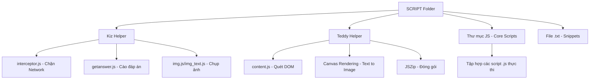

# Code-Graph: Hệ thống Tự động hóa FPTU (Thư mục SCRIPT)

Tài liệu này cung cấp cái nhìn tổng quan và chi tiết về cấu trúc, chức năng cũng như cơ chế hoạt động của các script và extension có trong thư mục `SCRIPT`.

---

## 1. Tổng Quan Hệ Thống

Thư mục `SCRIPT` chứa các công cụ tự động hóa được thiết kế để hỗ trợ việc lấy đáp án, tải câu hỏi và quản lý dữ liệu trên các nền tảng học tập/thi cử của FPTU (như Kizspy, PinkTeddy).

### Sơ đồ kiến trúc tổng quát

---

## 2. Phân Tích Chi Tiết Các Thành Phần

### A. Kiz Helper (Dành cho app.kizspy.me)
Đây là một Chrome Extension (Manifest V3) hỗ trợ đắc lực cho việc khai thác dữ liệu từ Kizspy.

1.  **Cơ chế Chặn gói tin (interceptor.js):**
    *   **Hoạt động:** Ghi đè (Override) hàm `XMLHttpRequest.prototype.send` và `window.fetch`.
    *   **Mục đích:** Theo dõi các request gửi đến endpoint `/watcher`. Khi tìm thấy dữ liệu `doing` (mã bài thi), nó sẽ gửi thông báo `EXAM_CODE_FOUND` về extension.
2.  **Cơ chế Lấy đáp án (getanswer.js):**
    *   Tự động click qua từng câu hỏi bằng cách mô phỏng hành động click vào các nút phân trang (`.page-link`).
    *   Đợi nội dung load, sau đó tìm các phần tử có class `.page-item.active` để xác định đáp án đúng và lưu lại.
3.  **Cơ chế Chụp ảnh/Text (img.js & img_text.js):**
    *   `img.js`: Tải ảnh câu hỏi trực tiếp từ URL, sau đó dùng Canvas để vẽ thêm số câu và các lựa chọn đáp án vào ảnh đó.
    *   `img_text.js`: Sử dụng thư viện `html2canvas` để chụp lại vùng văn bản câu hỏi (`#NC_text`) và chuyển thành ảnh.
4.  **Tự động xóa dữ liệu (autodelete.js):**
    *   Nhận một danh sách các mã bài thi, tự động điều hướng và thực hiện các thao tác xóa dữ liệu theo chu kỳ thời gian (delay) được thiết lập.

### B. Teddy Helper (Dành cho PinkTeddy)
Extension này tập trung vào việc tải hàng loạt câu hỏi và chuyển đổi chúng sang dạng ảnh để dễ lưu trữ.

1.  **Quét nội dung (content.js):**
    *   Sử dụng các selector phức tạp để nhận diện vùng chứa câu hỏi (container).
    *   Phân loại câu hỏi: Dạng **Ảnh** (nếu có thẻ `img`) hoặc dạng **Văn bản** (nếu không có ảnh).
2.  **Chuyển Text sang Ảnh (Text-to-Image):**
    *   Nếu câu hỏi là văn bản, script sẽ tạo một `canvas`, tính toán độ dài dòng (wrap text) và vẽ văn bản lên canvas đó.
    *   **Kết quả:** Một bức ảnh chuyên nghiệp có nền trắng, chữ đen, viền rõ ràng và có đánh số câu ở góc.
3.  **Đóng gói dữ liệu:**
    *   Sử dụng thư viện `JSZip` để gom tất cả các ảnh đã xử lý vào một file `.zip` duy nhất và tải về máy người dùng.

### C. Thư mục JS & Các File Text
*   **Thư mục JS:** Chứa bản sao của các script lõi. Điều này cho phép người dùng có thể nhúng thủ công vào console trình duyệt nếu không muốn cài extension.
*   **Các file .txt:** Là các đoạn code snippet nhanh (ví dụ: `Lấy đáp án.txt`). Người dùng chỉ cần copy và paste vào Console của trình duyệt để thực thi nhanh một chức năng cụ thể.

---

## 3. Các Công Nghệ & Kỹ Thuật Chính

| Kỹ thuật | Chi tiết |
| :--- | :--- |
| **DOM Scraping** | Sử dụng `querySelector`, `querySelectorAll` để trích xuất thông tin từ trang web. |
| **Network Hooking** | Ghi đè API của trình duyệt để bắt trộm dữ liệu từ server trả về. |
| **Canvas API** | Xử lý đồ họa, vẽ thêm chữ vào ảnh hoặc tạo ảnh từ văn bản. |
| **Asynchronous JS** | Sử dụng `async/await` và `Promise` để xử lý các luồng đợi trang web tải xong. |
| **Chrome Extension V3** | Sử dụng `service_worker`, `content_scripts` và `storage` để quản lý trạng thái. |

---

## 4. Luồng Xử Lý Dữ Liệu (Workflow)

1.  **Bước 1 - Khởi tạo:** Extension được kích hoạt khi người dùng mở trang web mục tiêu.
2.  **Bước 2 - Thu thập:**
    *   Nếu là lấy mã: `interceptor.js` âm thầm làm việc.
    *   Nếu là lấy ảnh: Người dùng bấm nút, script bắt đầu duyệt qua danh sách câu hỏi.
3.  **Bước 3 - Chế biến:** Các câu hỏi được đánh số, thêm đáp án hoặc chuyển đổi từ text sang ảnh thông qua Canvas.
4.  **Bước 4 - Xuất bản:** Dữ liệu được nén thành file `.zip` hoặc hiển thị trong một popup để người dùng copy.

---
> [!TIP]
> **Lưu ý:** Để hệ thống hoạt động ổn định nhất, nên sử dụng các bản Extension (Kiz Helper/Teddy Helper) thay vì chạy script thủ công, vì extension có khả năng quản lý quyền truy cập và tài nguyên tốt hơn.
